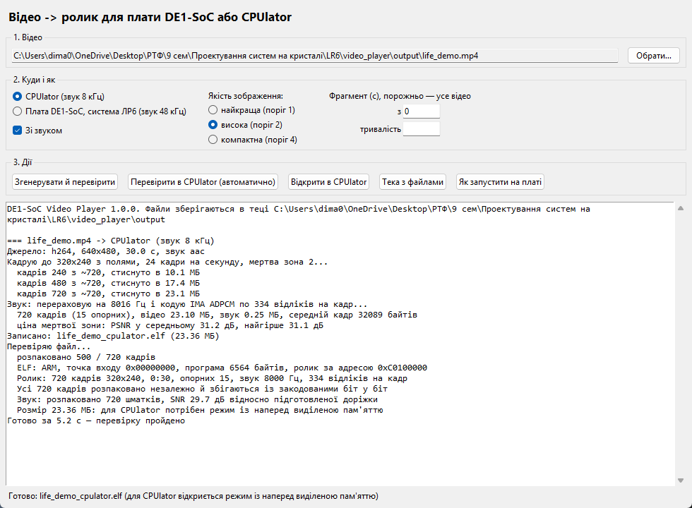
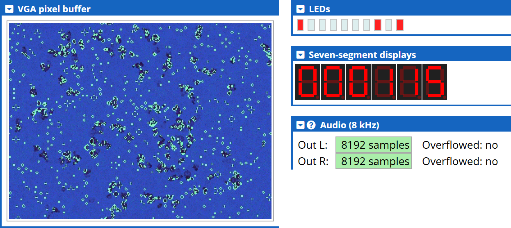
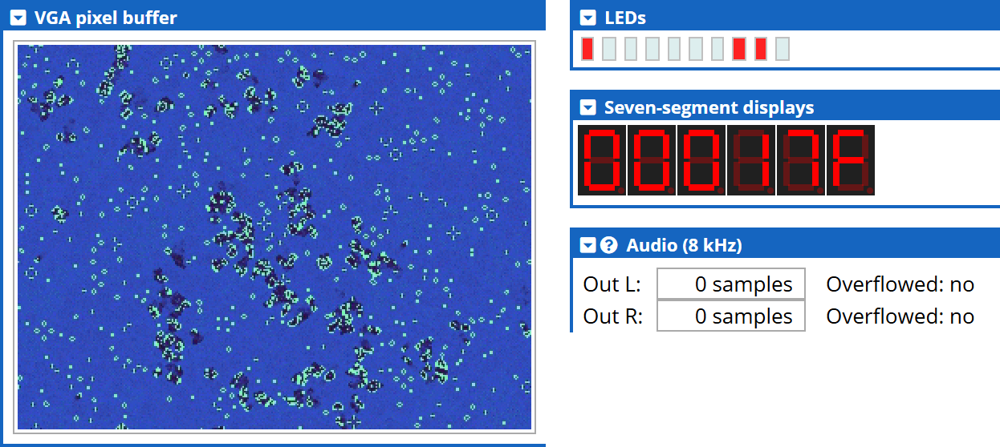
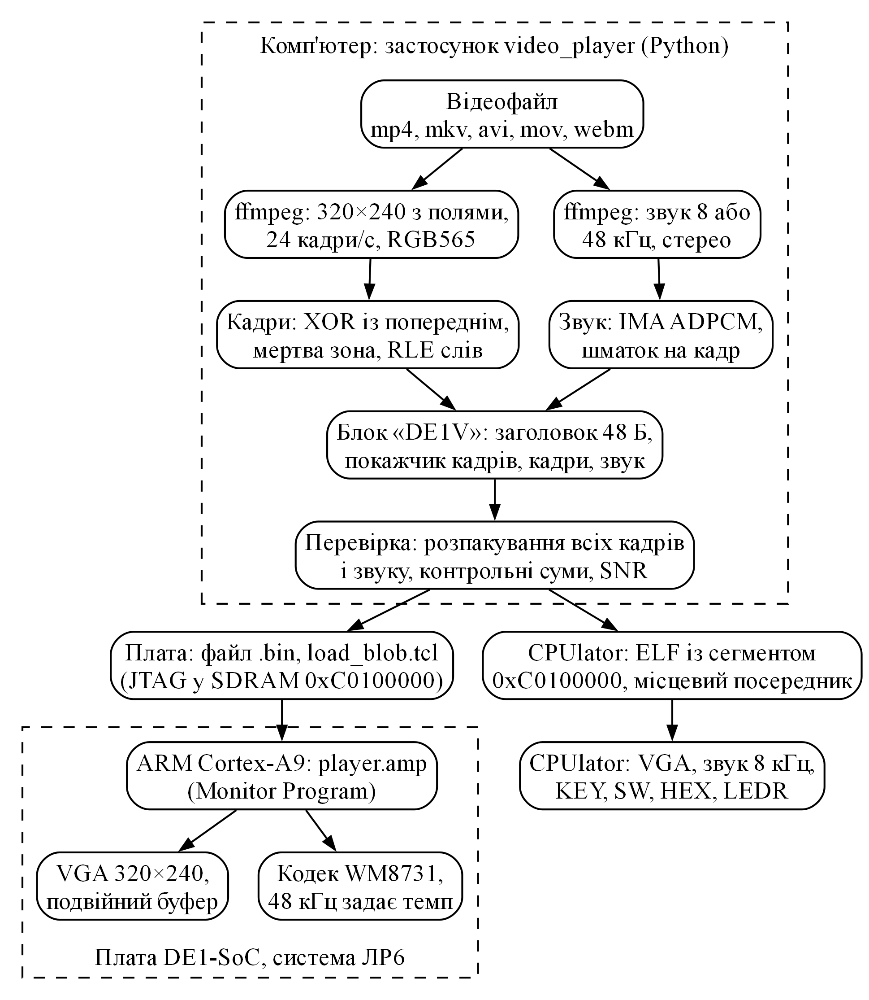
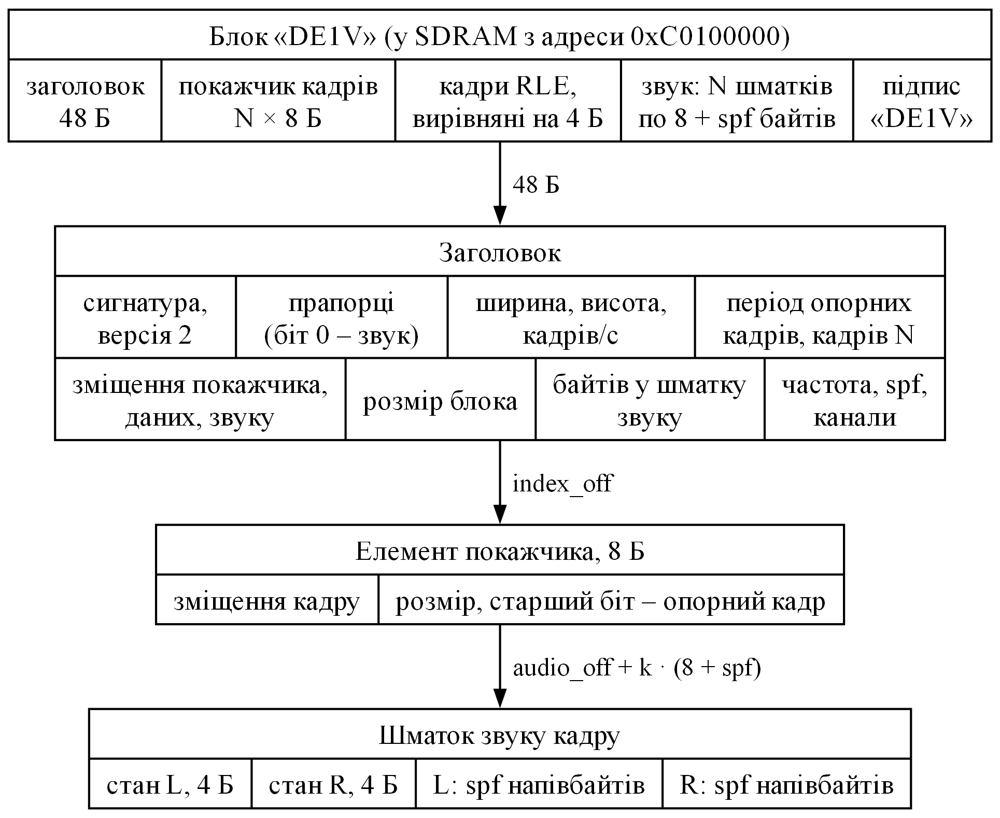
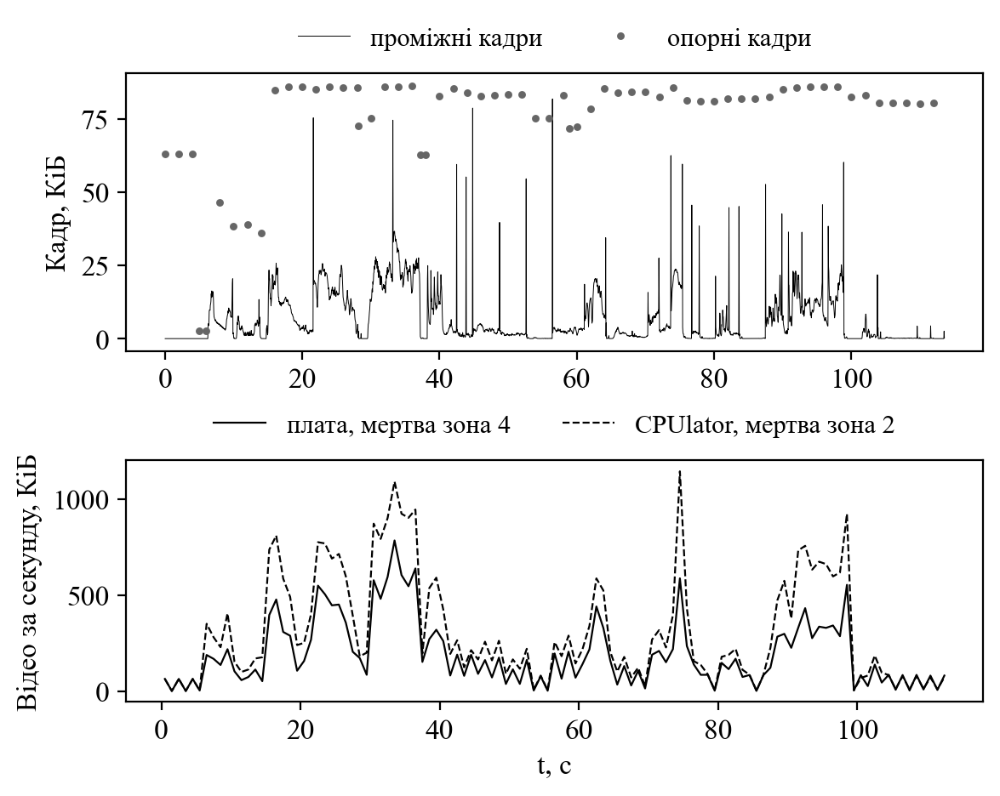
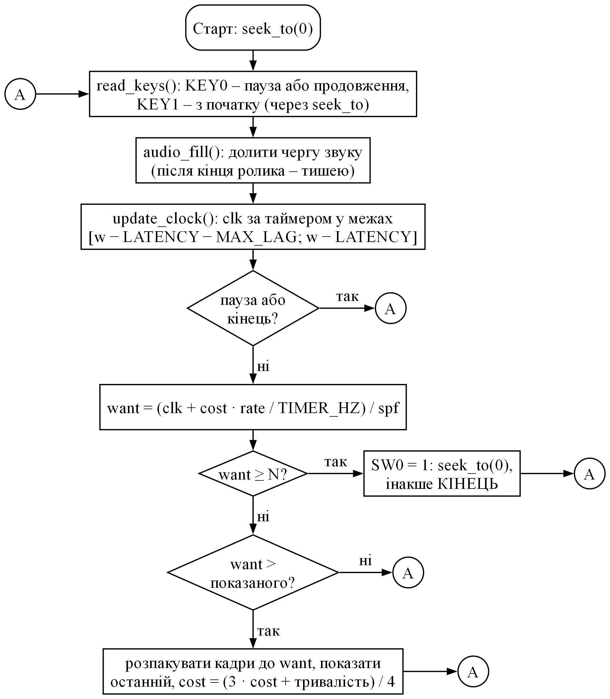
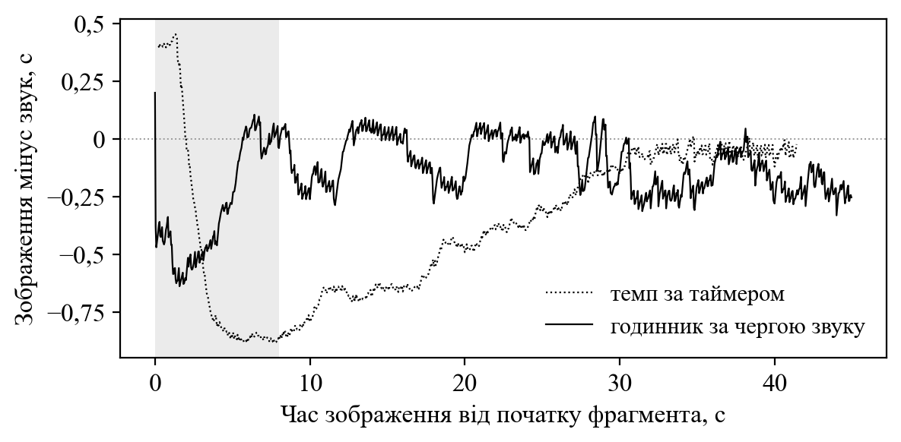
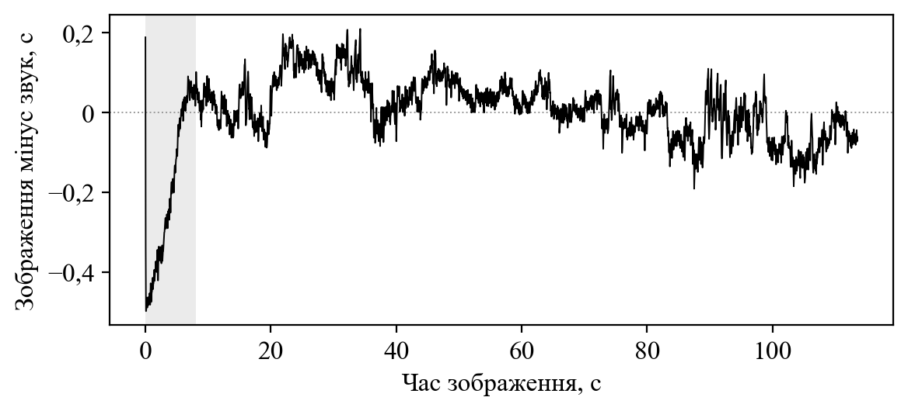

# DE1-SoC Video Player

Програвач відео зі звуком для плати **Terasic DE1-SoC** (ядро ARM Cortex-A9, вихід
VGA, кодек WM8731) і симулятора **[CPUlator](https://cpulator.01xz.net/?sys=arm-de1soc)**,
а також застосунок, що з відеофайлу (mp4, mkv, avi, mov, webm…) робить
готовий ролик, сам його перевіряє й відкриває CPUlator із уже завантаженим роликом.

Розширення лабораторної роботи №6 «Обробка відеосигналу» з курсу «Проектування
систем на кристалі» (КПІ ім. Ігоря Сікорського). Програвач аудіо до ЛР5 —
[de1soc-audio-player](https://github.com/RE22GDV/de1soc-audio-player).



## Що вміє

- **320×240, 24 кадри на секунду, звук стерео.** Кадр вписується в 4:3 з полями,
  кольори — RGB565 з упорядкованим розмиттям (bayer), щоб у темних сценах не було
  сходинок.
- **Без декодера відеоформатів на платі.** Стиснення — виключне «або» з попереднім
  кадром, мертва зона й кодування довжин серій по 16-розрядних словах. Розпакування
  не потребує множення, ділення й таблиць. Опорний кадр — щонайменше раз на 2 с,
  а також скрізь, де кадр цілком займає менше, ніж його різниця з попереднім
  (зазвичай на монтажних склейках).
- **Звук IMA ADPCM** (4 розряди на відлік) окремим шматком на кожен кадр: 2000
  відліків на 48 кГц для плати, 334 на 8 кГц для CPUlator. Кожен шматок
  розгортається незалежно, тож після паузи чи перезапуску звук іде з потрібного кадру
  без перерахунку стану декодера.
- **Кнопки:** KEY0 — пауза й продовження з того ж кадру, KEY1 — з початку,
  SW0 — по колу, SW2…SW1 — гучність. На HEX5…HEX0 — номер кадру, LEDR0 — показ,
  LEDR1 — пауза, LEDR2 — звук є, LEDR9 — хоч один кадр не встиг за 1/24 с.
- **Застосунок** кадрує й перераховує відео засобом ffmpeg (ставиться разом із
  бібліотеками, окремо нічого встановлювати не треба), стискає, складає файл без
  компілятора на вашому комп'ютері й перевіряє його: розпаковує всі кадри незалежним
  декодером і звіряє контрольні суми, рахує SNR звуку, PSNR зображення (ціну
  мертвої зони відносно кадрів після ffmpeg) і розмір.
- **Автоматична перевірка в CPUlator** у браузері без вікна: кадри йдуть, на VGA
  зображення, звук пишеться в чергу без переповнення, KEY0 і KEY1 працюють.
- **CPUlator для великих файлів.** Звичайний CPUlator на файлах понад ~2,4 МБ
  застигає (вада розширення пам'яті WebAssembly). Застосунок відкриває його через
  місцевий посередник, який виділяє пам'ять одразу (вмикається з 2,3 МБ, із
  запасом), — і весь ролик іде зі звуком.

| Показ у CPUlator | Пауза (KEY0) |
|---|---|
|  |  |

На знімках — синтетичний ролик «Гра життя» (30 с, згенерований засобом ffmpeg).
Під час показу — кадр 0x115, світяться LEDR0 і LEDR2, у черзі звуку 8192 відліки.
На паузі — кадр 0x11E, світиться LEDR1, черга звуку очищена. LEDR9 світиться, бо
на старті симулятор не встигає розпакувати опорні кадри за 1/24 с.

## Швидкий старт

1. Завантажте репозиторій (**Code → Download ZIP** або `git clone`) і розпакуйте.
2. Двічі клацніть **`run.bat`**. Перший запуск сам створить середовище Python і
   поставить бібліотеки разом з ffmpeg (близько хвилини, потрібен інтернет). Далі
   вікно відкривається одразу. Потрібен Python 3.10+
   ([python.org](https://www.python.org/downloads/)), для CPUlator — Chrome або Edge.
3. **Обрати…** → відео, у пункті «Куди і як» — ціль, якість і, за потреби, фрагмент.
4. **Згенерувати й перевірити.** Файли з'являться в теці `output`.
5. **Відкрити в CPUlator** → ролик завантажиться сам → натисніть **Continue мишею**
   (без клацання браузер не вмикає звук).

| Ціль | Звук | Якість за замовчуванням | Що отримуєте |
|---|---|---|---|
| CPUlator | 8 кГц, 334 відліки на кадр | висока (поріг 2) | `…_cpulator.elf` |
| Плата DE1-SoC, система ЛР6 | 48 кГц, 2000 відліків на кадр | компактна (поріг 4) | `…_board.bin`, `…_board_load.bat`, `load_blob.tcl` |

Відео обираєте своє: чужих роликів у репозиторії немає.

## Запуск на платі DE1-SoC

1. Прошийте ПЛІС системою ЛР6 зі звуком: `hardware/DE1_SoC_Computer.sof`
   (Quartus → Tools → Programmer → Add File → Start).
2. Монітор — до VGA, навушники або колонки — до зеленого гнізда **LINE OUT**.
3. **Intel FPGA Monitor Program → File → Open Project →
   `firmware/board/player.amp` → Actions → Load → Continue.** На HEX з'являться
   риски: програвач чекає на ролик.
4. Двічі клацніть `output/…_board_load.bat`. Він викликає `quartus_stp` і заливає
   ролик у SDRAM через міст JTAG-to-Avalon. Щойно дані доїдуть, показ почнеться сам.
   Порядок кроків 3 і 4 вільний.

Те саме є в застосунку на кнопці «Як запустити на платі». Перед першим запуском
можна прогнати `firmware/board/testpattern.amp`: кольорові смуги й шахівниця
перевіряють порядок байтів і крок рядка.

Програма й ролик заливаються окремо, бо Monitor Program вантажить через SREC, де
кожен байт — дві шістнадцяткові цифри: ролик на 28 МБ перетворився б на понад
56 МБ тексту.

## Як це влаштовано



**Ролик** — один двійковий блок «DE1V». На платі він лежить у SDRAM з адреси
`0xC0100000` (перший мегабайт — два буфери пікселів, бо контролер пікселів не
під'єднаний до DDR3). Скрипт заливки пише за адресою `0x00100000`: міст JTAG бачить
SDRAM з нуля, а ядро — через вікно `0xC0000000`. Для CPUlator той самий блок
вкладено в ELF окремим сегментом за адресою `0xC0100000`, тож програвач не знає,
звідки взялися дані.



Підпис «DE1V» стоїть і на початку, і в кінці блока: заливка йде від початку, тож
програвач починає показ, лише коли видно обидва. Покажчик кадрів дає зміщення
кожного кадру, тому шукати кадр не треба.

**Стиснення.** Кожен кадр — виключне «або» з попереднім, тож нерухомі ділянки й
чорні поля дають нулі. Мертва зона відкидає зміни, менші за поріг у кожній складовій
кольору (для зеленої — подвоєний, бо в неї шість розрядів), — це прибирає зерно й
шум, через які без неї стиснення трейлера було лише близько двократним. Далі — серії однакових слів:
слово зі старшим розрядом 1 — кількість «буквальних» слів, інакше — кількість
повторів і саме слово. На комп'ютері кодер працює масивами numpy: увесь
двохвилинний трейлер 1080p кадрується, стискається й перевіряється за 14–19 с.



**Темп на платі** задає кодек: він забирає рівно 2000 відліків за 1/24 с, і цикл
програвача стоїть рівно стільки, скільки треба, щоб їх віддати. Тому частоту
кадрів задає частота кодека, а окремого лічильника, який міг би накопичити
розбіжність звуку й зображення, немає (на платі це ще не перевірено, див.
«Обмеження»).

**Темп у CPUlator** так задати не можна. Звуковий порт симулятора забирає чергу
блоками по 2048 відліків (чверть секунди на 8 кГц), браузер планує кожен блок ще
близько 0,6 с наперед, а приватний таймер ядра залежить від навантаження й із
реальним часом не збігається. Тому в `firmware/cpulator/player_cpulator.c` номер
кадру береться з годинника — оцінки того, що зараз звучить. Годинник іде за
таймером, але не виходить за межі «записано в чергу мінус затримка» (той самий
прийом, що в аудіопрогравачі ЛР5). Кадр показується з упередженням на згладжену
тривалість його підготовки, а після кінця ролика в чергу пишеться тиша — інакше
годинник не дійшов би до останнього кадру. Розпакування, звук, буфери й кнопки —
слово в слово ті самі, що в програмі для плати.



Збіг зображення зі звуком виміряно в CPUlator (`tests/cpulator_sync.py`): скрипт
перехоплює планування блоків Web Audio на сторінці симулятора й порівнює його з
номером кадру на HEX. Фрагмент 45 с трейлера, після перших 8 с:



| Прошивка для CPUlator | Зображення мінус звук | Середнє |
|---|---|---|
| темп за таймером, звук на 16 кадрів наперед (попередній варіант) | −0,87…+0,01 с | −0,34 с |
| годинник за чергою звуку з упередженням (цей репозиторій) | −0,33…+0,10 с | −0,11 с |

Увесь трейлер (1:53) з цією прошивкою: після 8-ї секунди зображення мінус звук
−0,19…+0,21 с, у середньому +0,01 с, 84 % часу в межах ±0,1 с. Останній кадр
показано через 113,9 с після першого (тривалість ролика 113,6 с, звук іде на 0,2 %
повільніше). Симулятор встигає показати 2461 кадр із 2726 (у середньому 21,6 за
секунду), решту розпаковує, але не показує, щоб не відставати від звуку. Найдовша
пауза між показаними кадрами — 0,17 с. Перші секунди браузер лише розганяє
відтворення, і зображення відстає до 0,5 с (сіра смуга на графіках).



## Результати перевірки

Трейлер фільму, 1920×1080, 24 кадри/с, 1:53, звук AAC стерео (у репозиторій не
входить). 2726 кадрів, без стиснення відео зайняло б 418,7 МБ. Генерування разом із
перевіркою — 14–19 с на кожен варіант (на комп'ютері автора).

| Якість | Поріг | Відео | Стиснення | Опорних кадрів | PSNR сер. / мін. | Плата, файл `.bin` | CPUlator, `.elf` |
|---|---|---|---|---|---|---|---|
| найкраща | 1 | 52,68 МБ | 7,9× | 64 | 38,6 / 35,6 дБ | 58,18 МБ | 53,65 МБ |
| висока | 2 | 36,74 МБ | 11,4× | 62 | 34,8 / 30,3 дБ | 42,24 МБ | 37,70 МБ |
| компактна | 4 | 22,53 МБ | 18,6× | 61 | 29,9 / 24,5 дБ | 28,03 МБ | 23,49 МБ |

Звук для плати — 48 кГц, 5,47 МБ, SNR 40,9 дБ, для CPUlator — 8 кГц, 0,93 МБ,
SNR 25,9 дБ (відносно доріжки, уже перерахованої на потрібну частоту). PSNR
показує ціну мертвої зони відносно кадрів після ffmpeg. Усі шість файлів пройшли
перевірку: кожен кадр, розпакований незалежним декодером, збігся із закодованим
за контрольною сумою.

Автоматична перевірка в CPUlator (`python app\cli.py check output\test1_cpulator.elf
--cpulator --bigmem`, увесь трейлер, якість «висока»):

| Що перевіряється | Результат |
|---|---|
| завантаження | «Total size is 37866216 bytes» |
| програвач запущено | так |
| кадри йдуть | 25 → 183 за 6,2 с, 25,5 кадру/с на початку ролика |
| зображення на VGA | 9 різних знімків із 30, світлих пікселів до 56 % |
| звук | LEDR2 світиться, у черзі 6846…8192 відліки |
| переповнення черги звуку | немає ознаки Overflowed |
| KEY0 — пауза | кадр 186 не змінюється, світиться LEDR1 |
| KEY0 ще раз | показ продовжився: кадр 205 |
| KEY1 — з початку | кадр 1 |

Синтетичний ролик «Гра життя» (30 с, 640×480, 720 кадрів): ELF 23,36 МБ, PSNR
31,2 дБ, SNR 29,7 дБ.

Модульні тести (`python -m unittest discover tests`, 15 тестів): кодер серій дає
ті самі байти, що й покроковий еталон, розпакування повертає кадр біт у біт,
мертва зона з порогом 0 нічого не змінює, пошкодження блока виявляється,
повний ланцюг працює на відео з теки й назви кирилицею, посередник CPUlator
повторює запит після розірваного з'єднання.

## Командний рядок

```bat
python app\cli.py make відео.mp4 --target cpulator|board [--quality best|good|compact] [--no-audio] [--start С] [--length С]
python app\cli.py check output\файл.elf|файл.bin [--cpulator [--bigmem]]
python app\cli.py cpulator output\файл.elf [--bigmem]
python -m unittest discover tests
```

## Структура

```
app/                    застосунок (Python)
  main.py               вікно
  cli.py                командний рядок
  devideo/              media (ffmpeg), codec (RLE, мертва зона, IMA ADPCM),
                        blob (формат), elf, verify, make, helper (посередник
                        CPUlator), check (перевірка без вікна), cdp (Chrome)
firmware/
  board/                player.c і зібраний player.amp/.axf для плати,
                        testpattern — перевірка порядку байтів і кроку рядка
  cpulator/             player_cpulator.c, crt0.s, player_cpulator.ld, build.bat,
                        build/player_cpulator.elf — шаблон (компілятор не потрібен)
host/load_blob.tcl      заливка ролика в SDRAM через JTAG (quartus_stp)
hardware/               система ЛР6 зі звуком: .qsys, .sopcinfo, .sof
tests/                  test_codec, test_blob, test_make (теки й назви кирилицею),
                        test_helper (посередник CPUlator без інтернету),
                        cpulator_sync.py (збіг зображення зі звуком у CPUlator)
docs/                   рисунки, дані замірів і make_figures.py, що їх будує
run.bat                 запуск одним клацанням
```

## Обмеження

- На реальній платі програвач поки не запускався — плати не було. Програму для
  плати перевірено прогоном на комп'ютері з підставленими регістрами, відеотракт —
  моделюванням у ModelSim, логіку — у CPUlator.
- У CPUlator у найважчих сценах симулятор не встигає розпакувати 24 кадри за
  секунду: програвач пропускає показ проміжних кадрів (розпаковуючи їх) і світить
  LEDR9, а зображення в такі моменти відстає від звуку до ~0,3 с.
- Затримку черги 14 000 відліків виміряно в Chrome без вікна. В іншому браузері
  збіг зображення зі звуком може бути іншим.
- Звук для CPUlator перераховано на 8016 Гц (334 відліки на кадр), а грає він на
  8000 Гц: ролик іде на 0,2 % повільніше, тон на 0,2 % нижчий.
- Розмір ролика обмежено SDRAM: 63 МіБ після буферів пікселів.

---

Гандзюк Дмитро, група РС-61мн, КПІ ім. Ігоря Сікорського, 2026
